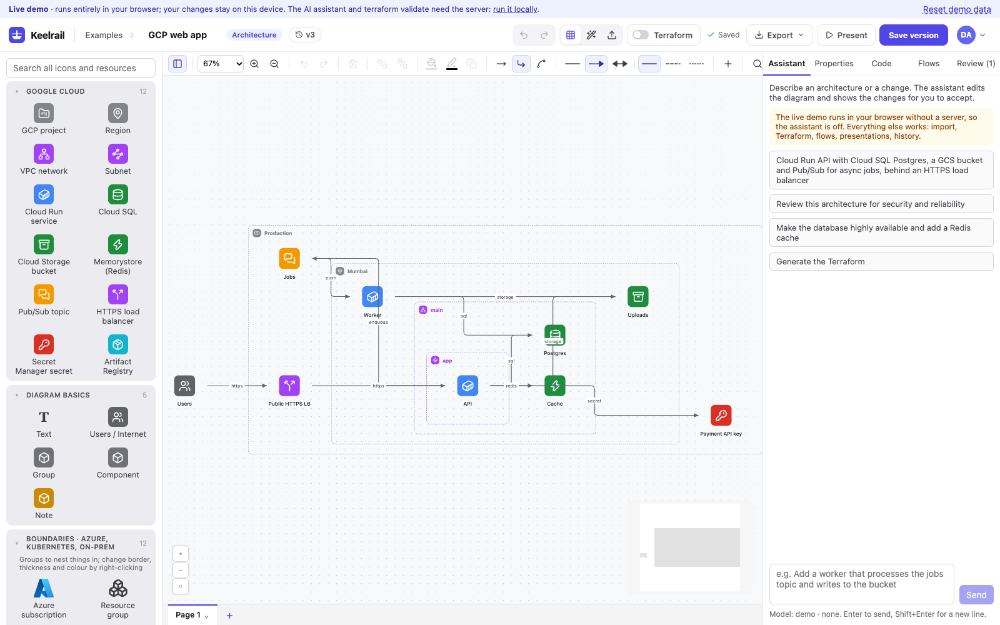
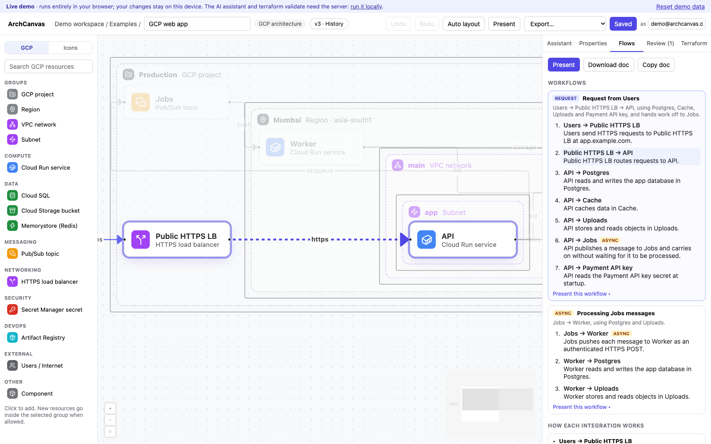
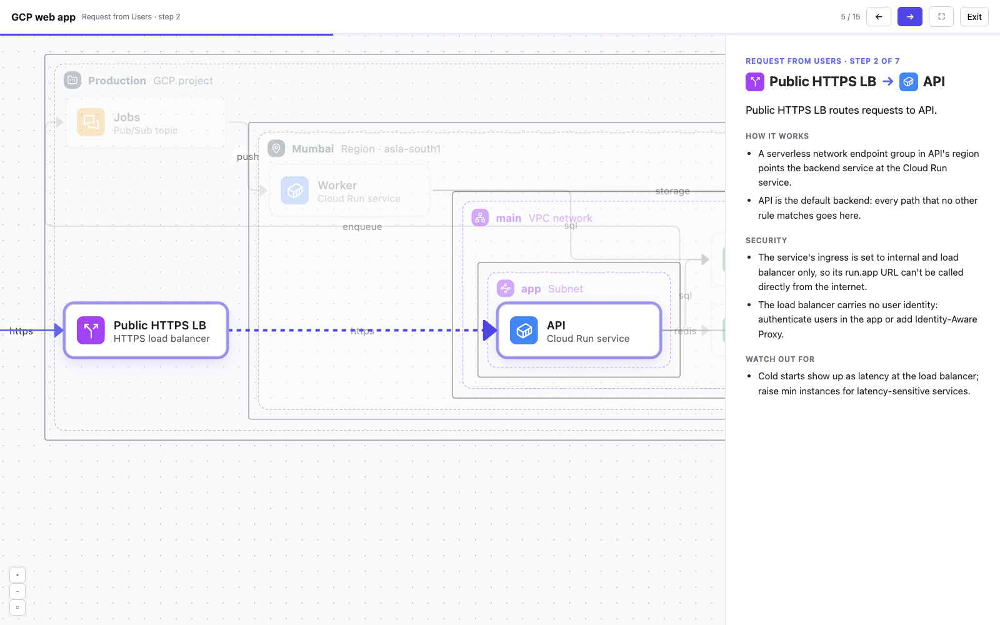
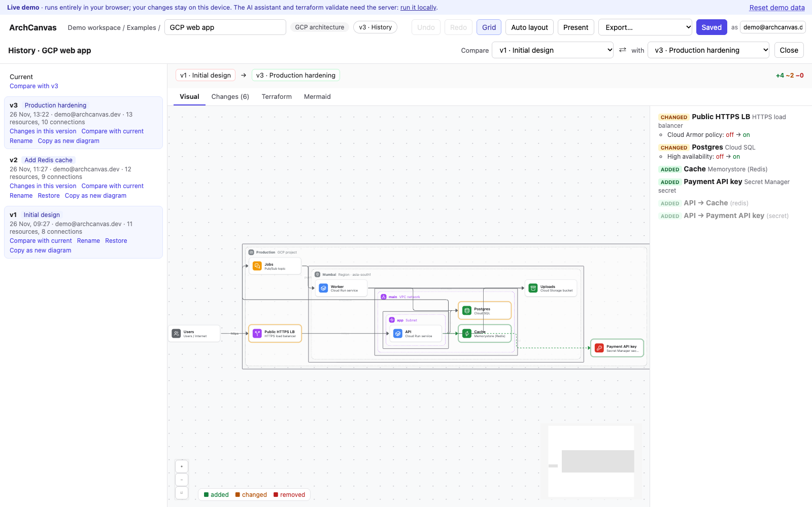
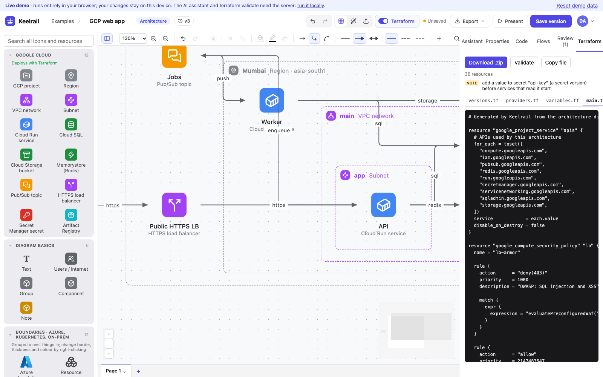
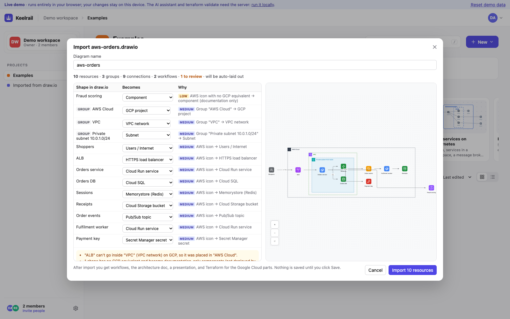
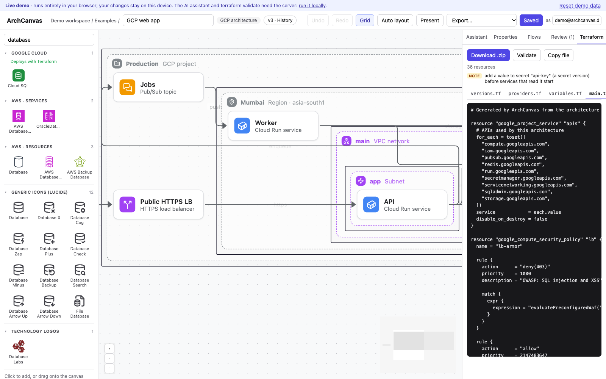
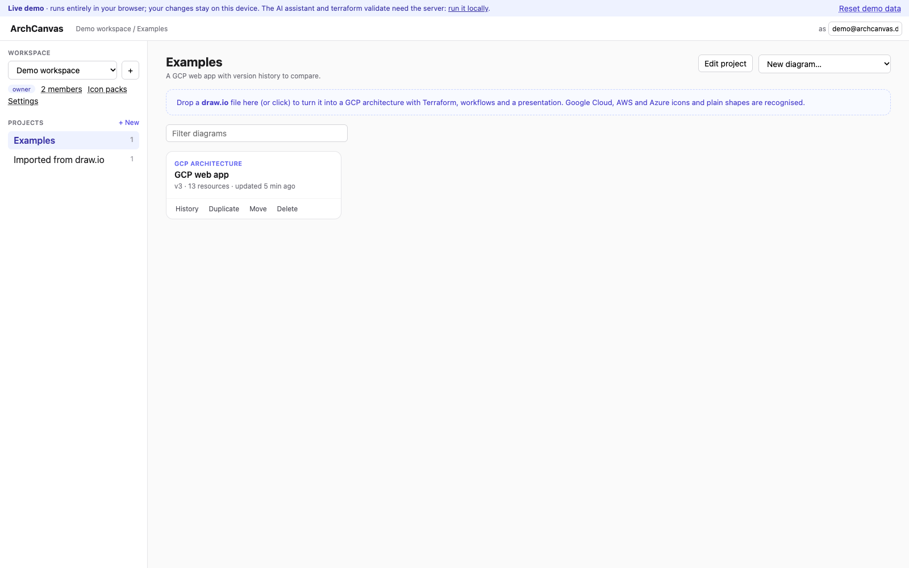

# ArchCanvas

**Draw your cloud architecture once and get the rest from it: Terraform, step-by-step workflows, documentation, a presentation, and a full version history you can compare.**

ArchCanvas is an AI-native architecture diagramming tool for Google Cloud. Each diagram is a typed model, not a picture. It knows a Cloud Run service is talking to Cloud SQL, so it can generate the IAM, networking and Terraform for that connection, explain how it works, and show what changed between two versions. You can start from scratch, describe the system to the assistant (Gemini), or import an existing draw.io diagram, including AWS ones.

**[▶ Try the live demo](https://krishnachaitanyap.github.io/arch_canvas/)**: it runs entirely in your browser with example diagrams. The AI assistant and `terraform validate` need the server ([run locally](#run-locally)).



## Highlights

| | |
|---|---|
| **Any cloud, on-prem, or a mix** | Start a **Blank architecture** and combine Google Cloud, AWS, Azure and on-prem: data centers, DMZs, accounts and subscriptions, Kubernetes clusters, servers, firewalls, mainframes and SaaS. Google Cloud resources also generate Terraform; everything else is documentation that still shows up in workflows, docs and presentations. |
| **Typed GCP diagrams** | Projects, regions, VPCs and subnets as real nested groups; Cloud Run, Cloud SQL, Memorystore, Cloud Storage, Pub/Sub, load balancers, Secret Manager and Artifact Registry as resources with settings. A review panel flags security and reliability issues. |
| **Edit like draw.io** | Drag from the palette to the canvas or into a group; drag shapes between groups; resize groups and notes; double-click to rename shapes and line labels; box-select, align and distribute; copy, paste and duplicate; reconnect line ends; orthogonal, straight or curved lines; right-click menus; snap to grid; undo/redo. Auto layout only when you ask for it. |
| **Terraform from the diagram** | A deterministic compiler, not an LLM guess. Connections become least-privilege IAM, passwordless Cloud SQL login, private networking (VPC egress, private service access), authenticated Pub/Sub push subscriptions, and load balancers with Cloud Armor. Download as a zip, or run `terraform validate` on the server. |
| **Workflows and integrations** | Request and async workflows are generated from the connections. For every integration you get how it works, its security, configuration and caveats, always consistent with the Terraform. |
| **Presentation mode** | A full-screen walkthrough of each workflow, step by step, with the canvas zooming to the connection being explained. |
| **AI assistant (Gemini)** | "Add a Redis cache in front of the DB" becomes validated edits shown as a highlighted proposal that you accept or reject. It can also review the design, explain integrations and generate Terraform. |
| **Import from draw.io** | Google Cloud, AWS and Azure icons, plain shapes and labels are mapped to GCP resources (AWS RDS → Cloud SQL, SQS → Pub/Sub…). A review step lets you check and override each mapping. |
| **One icon palette** | A single searchable sidebar, in collapsible segments: Google Cloud (deployable), diagram basics (users, groups, notes), AWS groups (VPC, subnets, regions, accounts), AWS services and resources, Lucide and about 2,300 technology logos, plus packs you upload (such as Google Cloud's official icons). The sidebar is resizable and the tiles reflow. AWS group icons become real groups you can drop things into. |
| **Workspaces, projects, versions** | Owner, editor and viewer roles. Every save is a version you can name, restore or copy. Compare any two versions, or two different diagrams, visually, field by field, and as a Terraform diff. Readable URLs for every page (`/dashboard`, `/dashboard/default-workspace/general`, `/d/orders-api-612b054b`, `…/history`, `…/present`), so links, refresh and back/forward work. Diagram links keep working after a rename. |
| **Export** | draw.io (lossless round trip), SVG, PNG, Mermaid, PlantUML, JSON, and a Markdown architecture document. |
| **Cloud or self-hosted** | One codebase: GKE with Terraform and Helm, or any Kubernetes cluster including air-gapped installs. OIDC SSO, Postgres row-level security and an audit log. |

## Screenshots

| | |
|---|---|
|  **Workflows**: click a step to see it on the canvas. |  **Present**: a step-by-step walkthrough with how, security and caveats. |
|  **Compare** any two versions: added, changed and removed, field by field. |  **Terraform** generated from the diagram. |
|  **Import draw.io**: an AWS diagram mapped to GCP, with a reason for each mapping. |  **One palette**: search across Google Cloud, AWS, Lucide, logos and uploaded packs. |
|  **Workspaces and projects**, with a draw.io drop zone. | |

Screenshots are generated from the demo build with `node scripts/screenshots.mjs` (see the script for details).

## How it works

```
apps/
  web/       React + Vite. Structured editor (React Flow + ELK), whiteboard (Excalidraw + Mermaid),
             history/compare, presentation, draw.io import, icon library. Builds as a browser-only demo with VITE_DEMO=1.
  api/       Fastify (TypeScript). Workspaces/projects/diagrams/versions with role checks, Postgres RLS,
             LLM gateway (Gemini, Claude, OpenAI-compatible) with a tool-calling diagram agent, Terraform validation.
  collab/    Hocuspocus (Yjs) real-time server (not wired to the editor yet).
packages/
  shared/    The typed diagram model, GCP catalog, validated edit operations, Terraform compiler,
             workflows and integration explanations, compare, draw.io import/export, icon helpers.
deploy/      Dockerfiles, one Helm chart (GKE and self-hosted), GKE Terraform, Cloud Build.
docs/        Plan and roadmap, example draw.io file, screenshots.
```

Everything is derived from one model in `packages/shared`, so the editor, the agent, the Terraform, the workflows, the exports and the comparisons always agree.

## Run locally

Requirements: Node 20+. No Docker needed: `npm run dev:db` starts an embedded Postgres (data in `.data/pg`).

On a company network, if `npm install` fails with `SELF_SIGNED_CERT_IN_CHAIN`, `ECONNRESET` or `EPERM`, see [Installing behind a corporate network](docs/enterprise-network.md).

No Postgres at all? `npm run dev:api:sqlite` runs the API on Node's built-in SQLite (Node 22.13+, data in `.data/archcanvas.sqlite`) for local use; see [the SQLite option](docs/enterprise-network.md#option-a-sqlite-nothing-extra-to-install).

```bash
cp .env.example .env            # set GEMINI_API_KEY (or another LLM_PROVIDER), PORT, API_PROXY_TARGET
npm install
npm run dev:db                  # Postgres on :5432
node --env-file=.env node_modules/tsx/dist/cli.mjs watch apps/api/src/index.ts     # API (runs migrations)
node --env-file=.env node_modules/vite/bin/vite.js apps/web --port 5174            # web app
npm test                        # unit tests
```

Install Terraform on the API host to enable **Validate** in the Terraform tab. Without OIDC (`OIDC_ISSUER` empty) the app runs in dev mode as `dev-user`; the "as" box in the top bar switches the acting user so you can try the roles.

Or the whole stack in containers: `docker compose up -d --build` → http://localhost:8000. Add `--profile sso` for Keycloak, `--profile local-llm` for Ollama.

### Browser-only demo

```bash
VITE_DEMO=1 VITE_BASE=/arch_canvas/ npm run build -w @archcanvas/web
node node_modules/vite/bin/vite.js preview apps/web --port 5180 --base /arch_canvas/
```

[`.github/workflows/pages.yml`](.github/workflows/pages.yml) publishes it to GitHub Pages on every push to `main`. One-time setup: **Settings → Pages → Source: GitHub Actions**.

## AI providers

Set `LLM_PROVIDER`:

| Value | Use for | Config |
|---|---|---|
| `gemini` | Default. Gemini API key, or Vertex AI when the key is empty | `GEMINI_API_KEY` or `VERTEX_PROJECT_ID`, `VERTEX_REGION`; `LLM_MODEL` |
| `anthropic` | Claude via the Anthropic API | `ANTHROPIC_API_KEY`, `LLM_MODEL` |
| `vertex` | Claude on Vertex AI (GCP, data stays in your project) | `VERTEX_PROJECT_ID`, `VERTEX_REGION`; auth via Workload Identity |
| `openai_compatible` | Self-hosted or air-gapped: vLLM, Ollama, LiteLLM, Azure OpenAI (text only; the agent needs tool calling) | `OPENAI_BASE_URL`, `OPENAI_API_KEY`, `LLM_MODEL` |
| `none` | AI disabled | — |

## Import from draw.io

Two ways in, both with a review step that shows how each shape was interpreted and lets you change it:

- **As a new diagram:** on a project page, drop a `.drawio`, `.xml` (plain or compressed, any number of pages) or `.drawio.svg` file on the dashed import box, or choose **New diagram… → Import draw.io file…**.
- **Into the open diagram:** click **Import** in the editor toolbar. The shapes are added to the right of what's already there.

Shapes are mapped like this:

| Source | Confidence | Example |
|---|---|---|
| ArchCanvas's own draw.io export | exact | lossless round trip, positions kept |
| Google Cloud icons | high | Cloud Run, Cloud SQL, Pub/Sub… |
| AWS and Azure icons | medium | Lambda/Fargate → Cloud Run, RDS → Cloud SQL, SQS → Pub/Sub, ElastiCache → Memorystore |
| Shapes | medium | cylinder → database, actor → users |
| Label keywords | low | "Orders API" → Cloud Run, "Session cache" → Memorystore |

Groups (AWS Cloud, VPC, subnet, or plain rectangles drawn around shapes) become GCP groups. Shapes with no GCP equivalent (for example SageMaker) become documentation-only components that keep their icon. Try it with [docs/examples/aws-orders.drawio](docs/examples/aws-orders.drawio).

## Icons and licensing

| Pack | License | Notes |
|---|---|---|
| AWS Architecture Icons | AWS terms (use in architecture diagrams) | 783 official icons, via the [`aws-icons`](https://www.npmjs.com/package/aws-icons) package |
| [Lucide](https://lucide.dev) | ISC | Generic architecture icons, also used for the default resource icons |
| [SVG Logos](https://github.com/gilbarbara/logos) | CC0-1.0 | About 2,300 technology logos (Postgres, Kafka, Kubernetes…) |
| Google Cloud icons | Google's terms | **Not bundled.** Download the zip from [cloud.google.com/icons](https://cloud.google.com/icons) and upload it under **Icon packs**; GCP resources then use it automatically. |

Packs are built into `apps/web/public/icons` by `apps/web/scripts/build-icons.mjs`, and each loads only when it's used. Uploaded SVGs are sanitised and always displayed through ``, so they can't run scripts.

## Deploy to GCP

```bash
cd deploy/terraform/gcp
terraform init && terraform apply -var project_id=<project> -var region=asia-south1
$(terraform output -raw get_credentials)

# images
cd ../../.. && gcloud builds submit --config cloudbuild.yaml --substitutions=_REGION=asia-south1,_TAG=0.1.0

# database secret (value lives in Secret Manager: terraform output database_url_secret)
kubectl create namespace archcanvas
kubectl -n archcanvas create secret generic archcanvas-db \
  --from-literal=DATABASE_URL="$(gcloud secrets versions access latest --secret=archcanvas-database-url)"

# app — edit deploy/helm/values-gcp.yaml first (project, host, issuer)
helm upgrade --install archcanvas deploy/helm/archcanvas -n archcanvas -f deploy/helm/values-gcp.yaml
```

Point your DNS A record at `terraform output ingress_ip`; the Google-managed certificate provisions once DNS resolves.

## Self-hosted install

```bash
helm upgrade --install archcanvas deploy/helm/archcanvas -n archcanvas --create-namespace \
  -f deploy/helm/values-selfhosted.yaml
```

- **Database:** any Postgres 14+ (CloudNativePG recommended). `postgresql.enabled=true` gives an in-cluster database for evaluation only.
- **SSO:** any OIDC issuer, such as Keycloak federated to Okta, Entra ID or LDAP. Tokens must carry a `tenant` claim (configurable via `auth.tenantClaim`).
- **Air-gapped:** mirror the three images into the customer registry and use `openai_compatible` with an in-cluster model server. The web app self-hosts its fonts and icons, so there are no CDN calls.

## Status

**Tested:**
- Unit tests for the model, Terraform compiler, workflows, compare, draw.io import, icons and the agent's tools.
- API smoke tests against Postgres 16, including role enforcement.
- The main UI flows in the browser.

**Not yet verified:**
- The AI assistant against a live Gemini model.
- `terraform validate` on the generated code.
- The API's production Docker build with the shared package (dev runs TypeScript through tsx).
- `helm lint`, and a real GKE deploy.

See [docs/PLAN-cloud-agent-iac.md](docs/PLAN-cloud-agent-iac.md) for what's done and next, and [docs/ROADMAP.md](docs/ROADMAP.md) for the longer roadmap.
