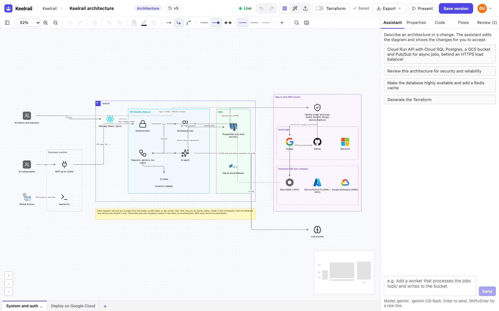
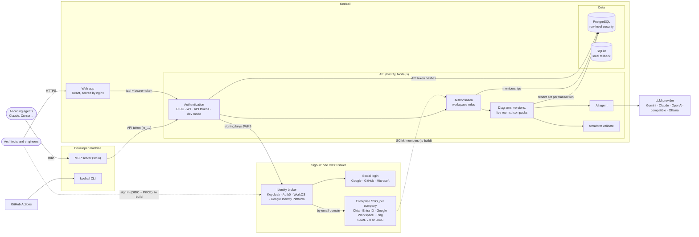
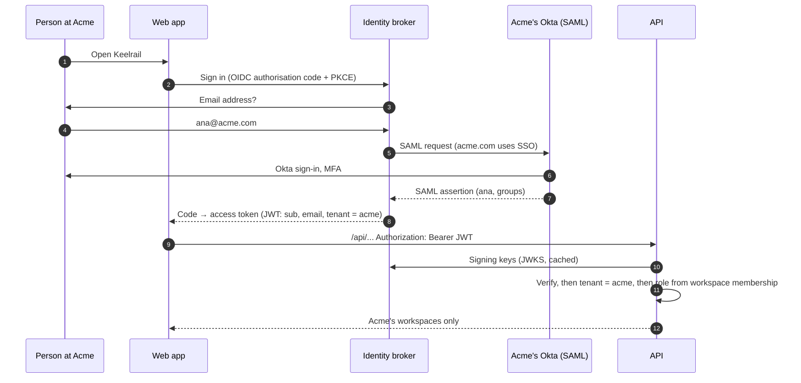
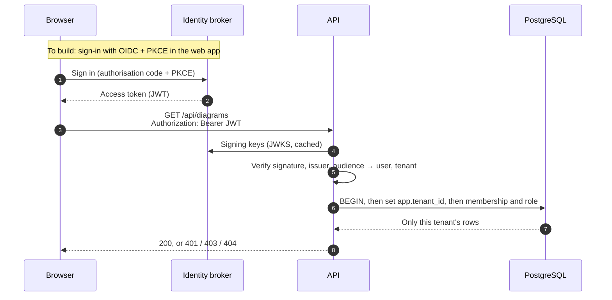
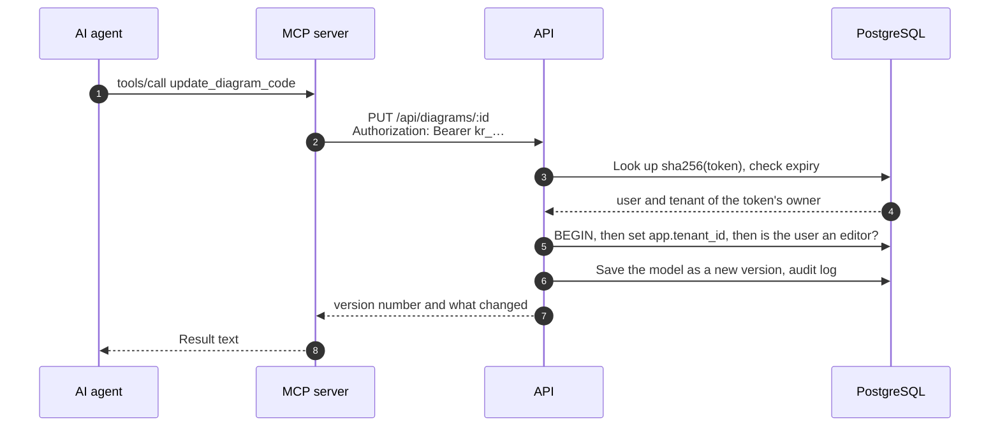
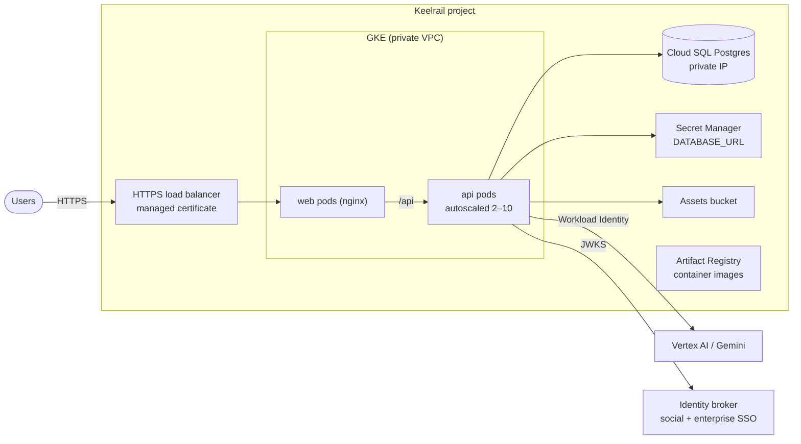

# Keelrail architecture

How Keelrail is built, how a request is authenticated and authorised, and how it runs on Google
Cloud. The diagram is kept as Keelrail diagram code in [`architecture.arch`](architecture.arch):
open it on the canvas (**Import** in any diagram), or check it with
`npm run keelrail -- check docs/architecture.arch`.

## Components

| Component | What it does | Code |
|---|---|---|
| Web app | The editor, dashboard, history and compare. Calls the API under `/api`; live editing uses a streaming connection per diagram. | `apps/web` |
| API | REST API, authentication and authorisation, live collaboration rooms, the AI agent, `terraform validate`. Stateless apart from live rooms (see *Scaling*). | `apps/api` |
| Shared model | The typed diagram model, Terraform compilers (GCP, AWS), diagram code, imports, workflows. Runs in the browser, the API, the CLI and the MCP server alike. | `packages/shared` |
| PostgreSQL | Workspaces, projects, diagrams, versions, members, icon packs, API tokens, audit log. Row-level security isolates tenants. SQLite replaces it for local use. | `apps/api/src/migrations` |
| MCP server | Lets AI agents read and change diagrams as code. Runs on the agent's machine and calls the API with an API token. | `scripts/mcp-server.mts` |
| CLI | Checks, diffs and compiles `.arch` files with no server; the GitHub workflow uses it on pull requests. | `scripts/arch.mts` |
| LLM provider | Gemini (API key or Vertex AI), Claude, or any OpenAI-compatible endpoint, including local models. Only the API talks to it. | `apps/api/src/llm.ts` |

## Sign-in: social login and enterprise SSO

Keelrail trusts **one OIDC issuer**: an identity broker. The broker handles every way people sign
in, so the API never deals with passwords, SAML or individual providers:

| Who | How they sign in | Lands in |
|---|---|---|
| Individuals and small teams | **Social login**: Google, GitHub or Microsoft account, or email and password with MFA | Their own tenant (created on first sign-in) |
| Companies | **Enterprise SSO**: the company's identity provider (Okta, Microsoft Entra ID, Google Workspace, Ping, ADFS) over **SAML 2.0 or OIDC**, set up once per company | The company's tenant |
| Scripts, CI, AI agents | **API tokens** (not the broker) | The token owner's tenant |

- **Choosing the provider.** The sign-in page asks for an email address; a company's domain
  (`@acme.com`) routes to its SSO connection (home realm discovery), anything else to social
  login. Companies can require SSO for their domain, so members can't bypass it with a social
  account.
- **Tenant in the token.** The broker adds the tenant to every token (the `tenant` claim,
  `TENANT_CLAIM`): fixed per SSO connection, so everyone from that company shares its
  workspaces. The API reads it and row-level security does the rest.
- **Provisioning (SCIM 2.0).** Enterprises add and remove people in their identity provider;
  SCIM keeps Keelrail's members and roles in step, and removing someone there revokes access
  here.
- **Choice of broker.** Self-hosted and air-gapped installs use **Keycloak** (in
  `docker compose --profile sso`). The cloud service can use a hosted broker (Auth0, WorkOS,
  Google Identity Platform). Any broker that issues OIDC tokens works, because the API only
  checks the issuer, the audience and the signature.

## Authentication: who is calling

Every `/api` request goes through `authenticate` (`apps/api/src/auth.ts`), which accepts one of:

| Credential | Sent as | Checked by | Used by |
|---|---|---|---|
| **OIDC access token** (JWT) from the broker | `Authorization: Bearer <jwt>` | Signature against the broker's keys (JWKS, found by OIDC discovery), issuer and audience. The tenant comes from a claim (`TENANT_CLAIM`, default `tenant`). | People in the browser, whether they used social login or enterprise SSO |
| **API token** | `Authorization: Bearer kr_…` | SHA-256 hash looked up in `api_tokens`; expiry checked; `last_used_at` updated. Acts as the user who made it, with their roles. Old `ac_` tokens still work. | Scripts, CI, the MCP server |
| **Dev mode** | nothing, or `x-dev-user: <name>` | Only when `OIDC_ISSUER` is empty: everyone is `dev-user` (or the named user) in tenant `default`. | Local development and the demo |

## Authorisation: what the caller may do

1. **Tenant isolation (database).** Every request runs in a transaction that sets
   `app.tenant_id`; Postgres row-level-security policies on every tenant table only return
   that tenant's rows, so a query that forgets a filter still can't read another tenant's data.
   (SQLite has no row-level security, which is why it's for local use only.)
2. **Workspace roles (API).** `requireWorkspace`, `requireProject` and `requireDiagram`
   (`apps/api/src/access.ts`) check the caller's role in the workspace that owns the resource:

   | Role | Can |
   |---|---|
   | Viewer | Open diagrams, history and comparisons; join live sessions (see others, can't change) |
   | Editor | Everything a viewer can, plus create and change projects and diagrams, upload icon packs |
   | Owner | Everything an editor can, plus manage members, rename and delete the workspace |

   Something in a workspace you're not a member of is reported as *not found*, so its
   existence isn't revealed.
3. **Live sessions.** Joining a diagram's live room needs the viewer role; sending changes needs
   editor. A connection can only be used by the user who opened it.
4. **Audit log.** Changes to diagrams, members and settings, and AI agent runs, are written to
   `audit_log` with the acting user.

## Running on Google Cloud

Terraform in `deploy/terraform/gcp`, Helm chart in `deploy/helm/archcanvas`. The same chart runs
self-hosted on any Kubernetes cluster, including air-gapped ones; `docker compose up` runs the
whole stack on one machine.

## Known gaps

- **Browser sign-in isn't built yet.** The API verifies OIDC tokens, but the web app never
  obtains one (`setTokenProvider` in `apps/web/src/api.ts` is never called). With
  `OIDC_ISSUER` set, the API works for API tokens (scripts, CI, MCP) but the web app can't sign
  in. Next steps:
  1. OIDC authorisation-code + PKCE sign-in in the web app, with token refresh and a sign-out
     item in the account menu.
  2. A Keycloak realm for `docker compose --profile sso` with Google, GitHub and Microsoft
     sign-in and an example SAML connection.
  3. First sign-in: create the person's tenant and a default workspace (social), or add them to
     their company's tenant (SSO).
  4. SCIM 2.0 endpoints (`/scim/v2/Users`, `/Groups`) for enterprise provisioning, and an
     owner setting to require SSO for a domain.
- **Live rooms live in one API process.** With several API replicas, route each diagram to the
  same replica (sticky sessions on the diagram id) or relay room events through Redis.
- **The collaboration server (`apps/collab`)** is for whiteboards and isn't connected to the
  editor; architecture diagrams use the API's live rooms instead.
